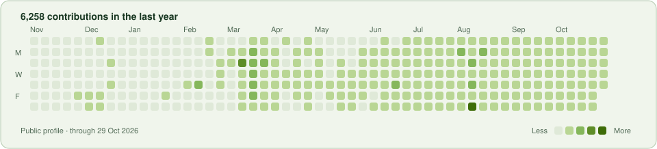

<picture>
  <source media="(prefers-color-scheme: dark) and (max-width: 600px)" srcset="assets/hero-dark-mobile.svg">
  <source media="(max-width: 600px)" srcset="assets/hero-light-mobile.svg">
  <source media="(prefers-color-scheme: dark)" srcset="assets/hero-dark.svg">
  
</picture>

  <a href="#whoami"><code>./whoami</code></a> &nbsp; / &nbsp;
  <a href="#selected-work"><code>./lab</code></a> &nbsp; / &nbsp;
  <a href="#at-the-workbench"><code>./toolbox</code></a> &nbsp; / &nbsp;
  <a href="#connect"><code>./connect</code></a>

### `$ whoami`

I'm **Mahmoud Mohseni**, aka **StealthMoud**. I build security tools and backend applications. I'm drawn to the places where trust breaks: inputs, identities, sessions, and access controls.

My projects move between investigating how applications fail and building systems with authentication and access controls. Curiosity starts the investigation; reproducible evidence makes it useful.

<picture>
  <source media="(prefers-color-scheme: dark) and (max-width: 600px)" srcset="assets/flow-dark-mobile.svg">
  <source media="(max-width: 600px)" srcset="assets/flow-light-mobile.svg">
  <source media="(prefers-color-scheme: dark)" srcset="assets/flow-dark.svg">
  
</picture>

## `~/lab` Selected work

### [Tarsius](https://github.com/StealthMoud/Tarsius)

**A web security scanner, from discovery to reporting.**

A Node.js project that crawls pages and forms, runs vulnerability checks, and produces HTML, JSON, CSV, and text reports. Includes a local vulnerable application for exercising the scanner.

`JavaScript` `Node.js` `Docker` `Web security`

[Explore the code ↗](https://github.com/StealthMoud/Tarsius) · [Read the usage guide](https://github.com/StealthMoud/Tarsius/blob/main/docs/usage_guide.md)

<table>
  <tr>
    <td width="50%" valign="top">
      CVE RESEARCH
      <h3><a href="https://github.com/StealthMoud/react-server-cve-lab">React Server CVE Lab ↗</a></h3>
      
A controlled environment for studying source exposure and denial of service in React Server Components.

      
<code>Python</code> <code>React</code> <code>Security research</code>

    </td>
    <td width="50%" valign="top">
      ACCESS CONTROL
      <h3><a href="https://github.com/StealthMoud/secure-note">SecureNote ↗</a></h3>
      
A note-sharing application exploring authentication, TOTP two-factor verification, roles, and per-note permissions.

      
<code>TypeScript</code> <code>Next.js</code> <code>Express</code>

    </td>
  </tr>
  <tr>
    <td width="50%" valign="top">
      VULNERABILITY ANALYSIS
      <h3><a href="https://github.com/StealthMoud/CVE-2025-55182-Scanner">React RCE Toolkit ↗</a></h3>
      
Testing tools and a technical walkthrough of CVE-2025-55182, focused on understanding the request-to-execution path.

      
<code>Shell</code> <code>React Server Components</code>

    </td>
    <td width="50%" valign="top">
      IDENTITY TOOLS
      <h3><a href="https://github.com/StealthMoud/authenticator">Authenticator ↗</a></h3>
      
A local-first Chrome extension for TOTP and HOTP codes, QR import, and optional sync to a private GitHub repository.

      
<code>JavaScript</code> <code>Chrome extension</code>

    </td>
  </tr>
</table>

  
<strong>More experiments from the lab</strong>

- [BlindSQLMapper](https://github.com/StealthMoud/BlindSQLMapper) — Boolean-based SQL injection tooling and time-based detection experiments.
- [SameSite Cookie Lab](https://github.com/StealthMoud/samesite-lab) — A local lab for comparing same-site and cross-site cookie behavior.
- [All public repositories](https://github.com/StealthMoud?tab=repositories) — Security tools, browser extensions, and other things I build.

## `~/toolbox` At the workbench

| Area | What interests me |
| :--- | :--- |
| **Application security** | Web and API testing, authentication, authorization, and input handling. |
| **Security tooling** | Reproducible labs, scanners, and reports that make results easier to investigate. |
| **Backend engineering** | Request flows, session handling, data access, and the boundaries between them. |

**Languages** &nbsp; Python · JavaScript · TypeScript · Bash 
**Tools & platforms** &nbsp; Burp Suite · Linux · Git · Docker · Node.js

> Understand the intended behavior. Question the assumptions. Reproduce what you find.

  
<strong>Contribution activity</strong>

   
  <picture>
    <source media="(prefers-color-scheme: dark)" srcset="assets/activity-dark.svg">
    
  </picture>
  
From the public GitHub contribution calendar; refreshed daily. GitHub may include anonymized private contributions when enabled.

## `$ connect`

Interested in application security, backend engineering, or a project here? Let's talk.

[Email](mailto:stealthmoud@proton.me) &nbsp; / &nbsp; [LinkedIn](https://www.linkedin.com/in/sayed-mahmoud-mohseni-7299b72a1/) &nbsp; / &nbsp; [X](https://x.com/StealthMoud)

---

<code>[ end of transmission ]</code> &nbsp; Mahmoud Mohseni / StealthMoud

<!-- PROFILE_REFRESH:START -->
Automated maintenance: awaiting first scheduled run (Europe/Rome).
<!-- PROFILE_REFRESH:END -->
